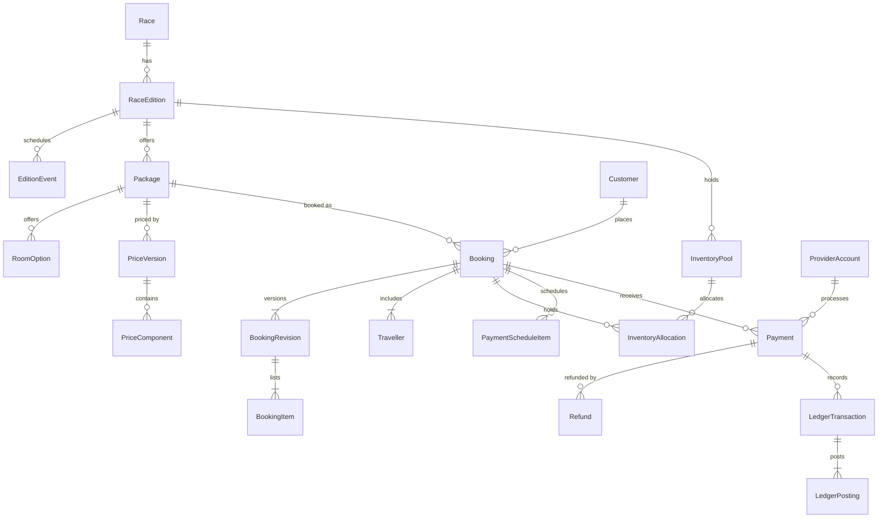

# Fase 0 · Plan de arquitectura y modelo de datos (tarea 0.1)

> **Estado: aprobado por Oscar el 2026-11-10**, con las respuestas de §5 y el orden de §4.2. Las decisiones están en `docs/decisions.md`. Este documento es el modelo de datos vigente.
>
> Fecha: 2026-11-10. Los nombres de entidades, campos y enumerados están en inglés australiano, como irán en el código.

## Resumen

1. **Todo se diseña ahora y se migra por fases.** Las tablas de un módulo futuro se crean cuando se construye ese módulo. Las tablas del núcleo nacen ya con las columnas y relaciones que los módulos futuros van a necesitar (§1.16). Añadir una tabla nueva es barato. Cambiar el significado de una tabla que ya tiene reservas y pagos es caro.
2. **Cuatro cambios de modelo respecto a la especificación** (detalle en §3):
   - La reserva tiene dos estados separados: ciclo de vida y cobro.
   - Lo que define cada persona es su tipo de viajero, no el tipo de paquete.
   - Los cupos son bolsas de inventario compartidas desde la fase 1.
   - El libro de pagos es de partida doble.
3. **Las garantías críticas se aplican en la base de datos, no solo en el código.** Los cupos no pueden bajar de cero. Las revisiones de reserva, el libro de pagos y la auditoría no se pueden editar ni borrar. Solo puede haber una versión de precio vigente a la vez.
4. **Orden de fases aprobado** (§4.2):
   - La fase 4 se parte en dos alrededor de la fase 5.
   - Las alertas suben a la fase 1.
   - La fase 9 pasa a ser bajo demanda.
   - Hay un único lanzamiento, al final, con todo construido.
5. **Propongo reducir el catálogo de pasarelas** a las que de verdad puedas llegar a usar. Cuarenta adaptadores que no podrás verificar son un riesgo, no una protección.

---

## 1. Modelo de datos

### 1.1 Principios

- **La API es la única fuente de verdad.** El motor de precios, las transiciones de estado y la asignación de cupos solo existen en la API. `packages/shared` no contiene lógica de precios, para que el navegador no pueda calcular un total ni por accidente.
- **Lo que tiene consecuencias legales o de dinero no se edita.** Las revisiones de reserva, los asientos del libro, la auditoría, las versiones de precio publicadas, las versiones de condiciones y los documentos emitidos no se modifican. Un cambio crea un registro nuevo que apunta al anterior.
- **Configuración antes que código, pero con tipos.** Reglas de precio, condiciones de automatización, campos personalizados y formatos de exportación se guardan en `jsonb`. Cada uno se valida con un esquema `zod` versionado: no hay JSON libre.
- **Datos personales mínimos y clasificados.** Cada columna con datos personales se marca en el esquema. Con esa marca se generan la exportación y el borrado de un cliente y se ocultan esos datos en la auditoría y en los registros (§1.2).

### 1.2 Convenciones transversales

| Tema | Convención |
|---|---|
| Identificadores | UUIDv7 generado en la aplicación (`uuid`), ordenable por tiempo. Las referencias para humanos van aparte: reserva `MT-K7Q3XP`, recibo `R-2026-000123`, referencia de PayID. Se usa un alfabeto sin caracteres ambiguos (sin 0/O ni 1/I). |
| Dinero | `amountMinor` en `bigint` más `currency` en `char(3)` (ISO 4217). En el dominio, un objeto de valor `Money`; en el JSON de la API, un entero más el código de moneda; la serialización convierte el `BigInt` de Prisma en número y comprueba que sea un entero seguro de JavaScript, y los esquemas zod usan `int().safe()`. Se usa `bigint` y no `int` porque los costes en monedas como VND o JPY pueden superar el máximo de 32 bits, y las sumas también. No hay decimales en importes. Los tipos de cambio son `numeric(18,8)`, porque no son dinero. |
| Redondeo (propuesta, se fija en 2.1) | Los porcentajes se aplican línea a línea y cada línea se redondea al céntimo con *half-up*. El total es la suma de las líneas ya redondeadas y nunca se redondea aparte. Un importe por reserva que haya que repartir entre viajeros se reparte por el método del mayor resto. |
| Fechas | `timestamptz` en UTC para instantes y `date` para fechas de calendario (carrera, entrada y salida del hotel). Los plazos (saldo, retenciones, datos de viajeros) son instantes calculados en la zona del negocio, `Australia/Brisbane`, que es configurable y no tiene horario de verano. Cada carrera guarda su zona IANA para mostrar las horas locales. |
| Texto traducible | `jsonb` con forma `{"en-AU": "…", "es": "…"}`, validado, que si falta un idioma usa `en-AU`. Los slugs van en una tabla `Slug` por idioma, que además conserva los slugs antiguos para redirigirlos con 301. Añadir un idioma no cambia el esquema, como pide el criterio de la fase 8. |
| Campos comunes | `createdAt`, `updatedAt`, `createdById`, `updatedById` y `version` (bloqueo optimista, para que dos pestañas del panel no se pisen) en todo agregado editable. |
| Borrado lógico | `deletedAt` y `deletedById` en catálogo, CRM, proveedores y contenido. El libro, la auditoría, los eventos y los documentos no tienen borrado lógico. Las claves únicas se definen solo sobre las filas no borradas (índice parcial). |
| Campos personalizados | Una columna `customFields jsonb` con índice GIN en Race, RaceEdition, Package, Hotel, Customer, Traveller, Booking, Supplier y, más adelante, Partner. Se valida contra `CustomFieldDefinition`. |
| Vínculos polimórficos | `entityType` (enumerado) más `entityId` en Note, TagAssignment, Attachment, Task, AuditLog y SearchDocument. No tienen clave foránea: lo compensan el borrado lógico y la limpieza del borrado de un cliente. |
| Datos personales | Cada columna de texto o `jsonb` de **cualquier** tabla se clasifica en el esquema de Prisma con `/// @pii`, `/// @freetext` (texto libre que puede contener datos personales) o `/// @notpii`. Un script genera con eso el mapa de datos personales y la tabla `data_classification`, que se carga en cada migración para que la usen los triggers. En `customFields` la clasificación es clave a clave, según `CustomFieldDefinition.isPersonalData`. Una prueba falla si alguna columna de texto o `jsonb` está sin clasificar. |
| Datos demo | `isDemo` en las raíces del catálogo y en los clientes y reservas demo. En producción, la API pública excluye siempre lo marcado como demo y el sitemap también. La API se niega a arrancar si `SHOW_DEMO_DATA=true` con `NODE_ENV=production`, y el script de datos demo se niega a ejecutarse en producción. En local la web muestra los datos demo con una franja "DEMO". `isDemo` se hereda de la carrera o de la edición al crear el registro (también al duplicar) y no se puede cambiar después: un trigger lo impone, y un paquete demo no puede colgar de una edición real ni al revés. Un paquete demo nunca dispara alertas. |
| Integridad en la base de datos | Los CHECK, índices parciales, restricciones de exclusión y triggers se escriben en SQL a mano dentro de las migraciones, porque Prisma no los expresa. Una prueba de integración consulta `pg_catalog` y falla si alguno desaparece. |
| Roles de la base de datos | Hay dos roles. `migrator` es el dueño del esquema. `app` solo puede leer y escribir datos, y no tiene `UPDATE` ni `DELETE` sobre las tablas inmutables (fila siguiente). A eso se suman triggers que rechazan esas operaciones aunque alguien conceda el permiso. |
| Tablas inmutables | AuditLog, BookingRevision, BookingItem, BookingStatusChange, ConsentRecord, LedgerTransaction y LedgerPosting no admiten `UPDATE` ni `DELETE`. Las líneas hijas (apuntes del libro y líneas de revisión) solo se pueden insertar en la misma transacción de base de datos que creó su cabecera: la cabecera guarda `txid_current()` y un trigger lo compara. Las versiones publicadas de PriceVersion, TemplateVersion y TermsVersion, y los Document emitidos, solo admiten los cambios que su fila indica. **Única excepción:** la función `redact_personal_data(customerId)`, que se ejecuta con un rol propio, sustituye por la marca `[redacted]` los valores `@pii` y `@freetext` de ese cliente en estas tablas y deja su propia entrada de auditoría. |
| Extensiones de PostgreSQL | `citext` (correos sin distinguir mayúsculas), `pg_trgm` (búsqueda aproximada), `btree_gist` (exclusión de rangos de validez) y `unaccent`. El alojamiento elegido en 0.7 tiene que ofrecerlas. |

### 1.3 Mapa de módulos

| Módulo | Nivel | Fase en que se construye | Entidades principales |
|---|---|---|---|
| Plataforma | Base | 0 | User, Session, Role, Permission, AuditLog, DomainEvent, FeatureFlag, Setting, FileObject, Note, Tag, Task, SavedView, CustomFieldDefinition, SearchDocument, Slug |
| Catálogo | Núcleo | 1 | Race, RaceDistance, RaceEdition, EditionEvent, EditionClaim, Hotel, HotelRoomType, Package, RoomOption, Extra |
| Inventario | Núcleo | 1 (amplía 6) | InventoryPool, InventoryAllocation |
| Precios | Núcleo | 1 (estructura), 2 | PriceVersion, PriceComponent, PriceRule, PromoCode, PromoRedemption, Quote, CancellationPolicy |
| CRM y reservas | Núcleo | 2 | Customer, ConsentRecord, Enquiry, Booking, BookingRevision, BookingItem, Traveller, BookingStatusChange, WaitlistEntry, SalesMarket |
| Pagos | Núcleo | 3–4 | PaymentAdapter, ProviderAccount, PaymentMethodConfig, RoutingRule, PaymentScheduleItem, PaymentLink, Payment, ManualPaymentConfirmation, Refund, Dispute, WebhookEvent, IdempotencyRecord, ProviderBalanceTransaction, Payout, ReconciliationRun |
| Libro | Núcleo | 3 | LedgerTransaction, LedgerPosting |
| Alertas | Núcleo | 1 (antes 5) | AlertSubscription, AlertDispatch, AlertDelivery (y ConsentRecord, que se adelanta a la fase 1) |
| Mensajería y documentos | Núcleo | 0.4 (base), 5 | MessageTemplate, TemplateVersion, MessageLog, EmailSuppression, Document, DocumentSequence, TermsVersion, TermsAcceptance |
| Privacidad | Núcleo | 5 | DataSubjectRequest, RetentionPolicy |
| Proveedores | 2.ª ola | 6 | Supplier, SupplierContact, SupplierContract, CostItem, SupplierInvoice, SupplierPayment, ExchangeRate |
| Cambios y cancelaciones | 2.ª ola | 6 | BookingAmendment, BookingCancellation |
| Finanzas | 2.ª ola | 6 | Vistas sobre el libro y los costes. AccountingExport como Document. |
| Operaciones | 2.ª ola | 7 | ItineraryItem, TravelArrangement, OrganiserExportFormat, OrganiserExportRun, KeyDate |
| Contenido | 2.ª ola | 8 | Page, PageRevision, FaqItem, Banner, Menu, MenuItem, MediaAsset, Redirect |
| Reclamaciones | 2.ª ola | 7 | Complaint |
| Automatizaciones | 2.ª ola | 7 | AutomationRule, AutomationRun |
| Informes y embudo | 2.ª ola | 7 | ReportDefinition, ReportSchedule, AnalyticsEvent |
| Integraciones | 2.ª ola | 8 | ApiKey, WebhookSubscription, WebhookDelivery |
| Grupos y clubes | Más adelante | — | BookingGroup |
| Socios y comisiones | Más adelante | — | Partner, PartnerMember, Commission, CommissionPayout |
| Campañas | Más adelante | — | Segment, Campaign, CampaignRecipient |
| Reseñas y encuestas | Más adelante | — | Survey, SurveyResponse, Review |
| Viajes a medida | Más adelante | — | Enquiry de tipo `custom_trip` más un Package privado (§1.15) |
| Más monedas y países | Más adelante | — | SalesMarket (ya existe desde la fase 2), ExchangeRate |

### 1.4 Plataforma (fase 0)

| Entidad | Campos principales | Reglas e índices |
|---|---|---|
| **User** | `kind` (`staff`, `customer`, `partner`, `service`), `email` (citext), `emailVerifiedAt`, `passwordHash` (argon2id, solo `staff`), `status` (`active`, `disabled`, `locked`), `failedLoginCount`, `lockedUntil`, `lastLoginAt`, `locale` | Único `(kind, email)`: tu correo puede ser a la vez personal y cliente de prueba sin mezclar las dos sesiones. CHECK: solo `staff` tiene contraseña. Tras intentos fallidos, espera creciente por cuenta y límite por IP; nunca un bloqueo indefinido, para que un tercero no pueda dejar fuera al único administrador. |
| **Session** | `tokenHash` (único; la cookie lleva el token y la base de datos solo su hash), `userId`, `expiresAt`, `idleExpiresAt`, `lastSeenAt`, `mfaVerifiedAt`, `stepUpAt` (segundo factor reciente, para acciones sensibles), `userAgent`, `ipHash` (HMAC con una clave que rota cada mes; un hash sin clave de una IPv4 se revierte), `revokedAt`, `revokeReason` | Cookies distintas para personal y clientes, con duraciones distintas: personal 30 min de inactividad y 12 h como máximo; cliente 30 días. Cookie del personal `SameSite=Strict`, del cliente `Lax`. Protección CSRF: toda petición que cambia datos comprueba `Origin` y `Sec-Fetch-Site`, porque `SameSite` no protege entre subdominios. |
| **OneTimeToken** | `purpose` (`login_link`, `email_change`, `alert_confirm`, `marketing_confirm`, `staff_invite`, `password_reset`), `tokenHash`, `email`, `userId?`, `payload`, `expiresAt`, `consumedAt`, `attempts` | Se usa una sola vez y caduca pronto. Los enlaces de baja no se guardan: van firmados con HMAC y no caducan. |
| **MfaFactor** | `userId`, `type` (`totp`; `webauthn` más adelante), `secretCiphertext`, `keyVersion`, `confirmedAt`, `lastUsedStep` | `lastUsedStep` impide reutilizar el mismo código TOTP. |
| **RecoveryCode** | `userId`, `codeHash`, `usedAt` | — |
| **Role** | `key`, `name`, `description`, `isSystem` | `admin` y `customer` son de sistema y no se pueden borrar. |
| **Permission** | `code` (p. ej. `booking.approve`, `payment.refund`, `provider_account.credentials.update`), `module`, `description`, `requiresStepUp` | Se definen en código y se sincronizan con la tabla, nunca se crean desde el panel. La matriz rol × permiso sí es editable. |
| **RolePermission** | `roleId`, `permissionCode` | — |
| **UserRole** | `userId`, `roleId`, `scopeType?` (`race_edition`, `supplier`), `scopeId?`, `grantedById`, `expiresAt?` | El ámbito sirve para dar a un guía acceso solo a su viaje. El modelo lo admite desde el principio; la interfaz llega cuando lo necesites. Mientras no exista la comprobación de ámbito, un CHECK exige `scopeType IS NULL`, para que una asignación con ámbito no dé acceso global por error. |
| **AuditLog** | `occurredAt`, `actorType` (`user`, `api_key`, `system`, `automation`, `provider_webhook`), `actorId`, `requestId`, `action` (`create`, `update`, `soft_delete`, `restore`, `state_change`, `login`, `login_failed`, `mfa_failed`, `export`, `permission_denied`…), `entityType`, `entityId`, `changes` (`{campo: [antes, después]}`), `reason?`, `metadata` | Solo se añaden filas. Índices `(entityType, entityId, occurredAt)` y `(actorId, occurredAt)`. Guarda valor anterior y nuevo de todos los campos, también los personales, como pide `architecture.md`; `customFields` se compara clave a clave. Al borrar un cliente, `redact_personal_data` sustituye sus valores personales y el texto libre (`reason`, `metadata`) por una marca (§3.7). El "historial por registro" de 0.5 es una vista de esta tabla, no otra tabla. |
| **DomainEvent** (outbox) | `type` (p. ej. `booking.confirmed`), `schemaVersion`, `aggregateType`, `aggregateId`, `payload` (solo identificadores y datos no personales), `actor`, `correlationId`, `occurredAt`, `publishedAt` | Se escribe en la misma transacción que el cambio. Un proceso lo publica y crea un trabajo de pg-boss por cada suscriptor. Se conserva 90 días. |
| **EventConsumption** | `consumer`, `eventId`, `processedAt` | Único `(consumer, eventId)`: cada suscriptor procesa cada evento una sola vez. |
| *Trabajos* | Tablas propias de pg-boss en el esquema `pgboss` | Fuera de Prisma. |
| **FeatureFlag** | `key`, `enabled`, `module`, `description`, `rules?` | Un flag por módulo. Un módulo apagado devuelve 404 en sus rutas e ignora sus eventos. |
| **Setting** | `key`, `value jsonb`, tipado en código | `businessLegalName`, `abn`, `gstRegistered`, `businessTimeZone`, `defaultCurrency`, `supportEmail`, `maintenanceMode`, plazos de retención de datos, `defaultRequestHoldHours` y `defaultDepositWindowHours`… |
| **FileObject** | `storageKey`, `mimeType`, `sizeBytes`, `sha256`, `originalName`, `visibility` (`private`, `public`), `purpose`, `uploadedById` | Los archivos privados se sirven con URL firmada de corta duración. |
| **Attachment** | `fileId`, `entityType`, `entityId`, `label`, `visibleToCustomer` | — |
| **Note** | `entityType`, `entityId`, `body`, `authorId`, `pinned` | Se trata como dato personal: el borrado de un cliente borra las notas de su ficha y de sus reservas. |
| **Tag** / **TagAssignment** | `key`, `label`, `colour`, `entityTypes[]` / `tagId`, `entityType`, `entityId` | Único `(tagId, entityType, entityId)`. |
| **Task** | `title`, `description`, `dueAt`, `status` (`open`, `done`, `cancelled`), `priority`, `assigneeId`, `entityType?`, `entityId?`, `source` (`manual`, `automation`, `key_date`), `sourceRef`, `completedAt` | — |
| **SavedView** | `ownerId?` (sin dueño = compartida), `entityType`, `name`, `query` (filtros, orden, columnas), `isDefault` | — |
| **CustomFieldDefinition** | `entityType`, `key`, `label` (traducible), `type` (`text`, `long_text`, `number`, `date`, `boolean`, `select`, `multi_select`, `email`, `url`), `options`, `validation`, `required`, `visibleToCustomer`, `editableByCustomer`, `isPersonalData`, `scopeRaceId?`, `position`, `archivedAt` | Una definición archivada se oculta, pero los valores guardados se conservan. El ámbito por carrera sirve para pedir solo los datos que exige cada organizador (§1.13). |
| **SearchDocument** | `entityType`, `entityId`, `title`, `subtitle`, `searchVector` (tsvector), `trigramText`, `updatedAt` | Lo mantienen los suscriptores de eventos y alimenta la búsqueda global del panel. |
| **Slug** | `entityType`, `entityId`, `locale`, `slug`, `isCurrent` | Único `(entityType, locale, slug)`. Si no es el slug actual, la web redirige con 301. |
| **DataJob** | `kind` (`import`, `export`, `bulk_action`), `entityType`, `fileId?`, `status`, `totalCount`, `okCount`, `errors`, `createdById` | Para CSV y acciones en lote, con resultado consultable. |

### 1.5 Catálogo (fase 1)

| Entidad | Campos principales | Reglas |
|---|---|---|
| **Race** | `name`, `countryCode` (ISO 3166-1), `region`, `city`, `timeZone`, `raceType` (`road`, `trail`, `ultra`, `track`, `multisport`, `other`), `typicalMonth`, `requestHoldHours` (cuánto retiene plaza una solicitud sin revisar), `depositWindowHours` (cuánto tiene el cliente para pagar el depósito tras la aprobación), `websiteUrl`, `guide` (traducible: `course`, `climate`, `howToGetEntry`, `travelTips`), `heroMediaId?`, `externalSource?`, `externalId?`, `status` (`active`, `archived`), `isDemo`, `customFields` | Los dos plazos de retención los fija cada carrera (respuesta 1). Al crear una carrera se rellenan con los valores por defecto de Setting. Único `(externalSource, externalId)`. El continente sale del país mediante una tabla estática en código. La guía de carrera es un campo estructurado de Race; las guías editoriales de la fase 8 son otra cosa, así que no hay que migrar nada. |
| **RaceDistance** | `raceId`, `category` (`5k`, `10k`, `half_marathon`, `marathon`, `ultra`, `other`), `distanceMetres`, `label` | Para filtrar por distancia aunque no haya edición abierta. |
| **RaceEdition** | `raceId`, `year`, `startDate`, `endDate`, `dateStatus` (`confirmed`, `provisional`, `to_be_confirmed`), `status` (`planned`, `on_sale`, `completed`, `cancelled`, `postponed`), `isDemo`, `customFields` | La web muestra de forma visible cualquier `dateStatus` distinto de `confirmed`. |
| **EditionEvent** | `editionId`, `raceDistanceId`, `date`, `startTime?`, `entryNameChangeAllowed`, `entryNameChangeDeadline?` | Cada salida concreta de una edición (el maratón del domingo, el 10K del sábado). Los dorsales son de un evento, no del paquete. |
| **EditionClaim** | `editionId`, `claim` (`official_partner`, `official_travel_agent`, `accredited_agent`), `evidenceFileId?`, `notes`, `activatedById`, `activatedAt`, `validUntil?`, `revokedAt?` | La web solo muestra un distintivo si existe una fila activa para esa edición, y la activación queda auditada con su prueba. Un trabajo programado emite `edition_claim.expired` al llegar `validUntil` y la web regenera la página. "Guaranteed entry" no se guarda aquí: se deduce **por paquete**, cuando el paquete admite `runner_with_entry` y la bolsa de dorsales de su evento tiene `confirmedBySupplier = true` y plazas libres. La web regenera la página con `inventory.exhausted` e `inventory.released`. |
| **Hotel** | `name`, dirección, `countryCode`, `city`, `latitude`, `longitude`, `starRating?`, `description` (traducible), `amenities[]`, `websiteUrl`, `supplierId?` (fase 6), `isDemo`, `customFields` | — |
| **HotelRoomType** | `hotelId`, `name` (traducible), `maxOccupancy` (1–4), `bedding`, `description` | — |
| **Package** | `editionId`, `name` (traducible), `salesStatus` (`draft`, `coming_soon`, `open`, `waitlist`, `sold_out`, `closed`), `bookingMode` (`on_request`, `instant`), `visibility` (`public`, `unlisted`, `private`), `checkInDate`, `checkOutDate`, `inclusions` y `exclusions` (listas traducibles), `allowedTravellerTypes[]`, `minTravellers`, `maxTravellers`, `depositRule` (`{type: per_person_fixed \| percentage, value}`), `balanceDueRule` (`{type: fixed_date \| days_before_departure, value}`), `travellerDataDeadlineRule`, `cancellationPolicyId`, `currency`, `duplicatedFromId?`, `lowStockThreshold`, `publishedAt`, `isDemo`, `customFields`, `version` | `checkOutDate > checkInDate`. `private` sirve para los viajes a medida (§1.15). El sistema pasa `open` a `sold_out` (y vuelta) con un evento de inventario; el resto de estados los cambias tú. |
| **RoomOption** | `packageId`, `hotelRoomTypeId`, `allowedOccupancies[]` (subconjunto de 1–4), `position`, `active` | El precio no vive aquí: vive en PriceVersion (§1.7). |
| **Extra** | `editionId`, `kind` (`excursion`, `transfer`, `meal`, `merchandise`, `service`, `other`), `name`, `description`, `pricingUnit` (`per_person`, `per_booking`, `per_night`), `date?`, `minQuantity`, `maxQuantity`, `applicableTravellerTypes[]`, `isDemo` | Pertenece a la edición para que varios paquetes compartan la misma excursión y su cupo. Las noches extra no son un Extra: se cobran por persona, noche y ocupación sobre la habitación (§1.7). |
| **PackageExtra** | `packageId`, `extraId`, `included` (incluido o de pago), `position` | — |
| **CancellationPolicy** | `name`, `tiers` (`[{fromDaysBefore, toDaysBefore, penalty: {type: percentage \| fixed_per_person \| non_refundable_items, value}}]`), `nonRefundableItemKinds[]` (p. ej. `entry`), `version`, `status` | Se guarda y se muestra desde la fase 2, y se copia en la revisión de la reserva. Una política ya usada no se edita: se crea una versión nueva. El cálculo automático llega en la fase 6. |

### 1.6 Inventario (fase 1; la fase 6 añade los contratos)

En lugar de poner un número de cupo en Package o en RoomOption, cada recurso limitado es una **bolsa** que comparten todos los paquetes de la edición. Por qué, en §3.3.

| Entidad | Campos principales | Reglas |
|---|---|---|
| **InventoryPool** | `editionId`, `kind` (`entry`, `room_night`, `extra`), `editionEventId?`, `hotelRoomTypeId?`, `nightDate?`, `extraId?`, `packageId?` (restringe la bolsa a un paquete), `capacity`, `allocated`, `confirmedBySupplier`, `onRequest` (sin cupo: se pide caso a caso), `lowStockThreshold`, `supplierContractId?` (fase 6), `releaseAt?` (fase 6), `releasedAt?`, `status` | `CHECK (allocated >= 0 AND allocated <= capacity)`. `allocated` no lo escribe la aplicación: lo mantiene un trigger a partir de InventoryAllocation (una fila nueva `held` suma su cantidad; el paso a `released` la resta una sola vez). Si una asignación deja `allocated` por encima de `capacity`, el CHECK hace fallar la transacción: no hay plaza. Si una reserva necesita varias bolsas, se bloquean en orden de `id` para evitar interbloqueos. |
| **InventoryAllocation** | `poolId`, `bookingId`, `bookingItemId?`, `quantity`, `status` (`held`, `confirmed`, `released`), `heldUntil?`, `releasedAt?`, `releaseReason?` | Se libera con `UPDATE … SET status = 'released' WHERE id = $1 AND status IN ('held', 'confirmed')`: si el rechazo de Oscar y la caducidad liberan a la vez, solo uno cambia la fila y el trigger resta una vez. Invariante: `allocated` es la suma de las asignaciones `held` y `confirmed`; un trabajo nocturno lo comprueba igualmente. |

Las habitaciones se cuentan **por noche**: una estancia de tres noches consume tres bolsas. Así las noches extra funcionan solas, y en la fase 6 un contrato de hotel por fechas encaja sin migrar nada. El panel lo esconde: tú escribes "20 habitaciones del viernes al lunes" y él crea las bolsas de cada noche.

### 1.7 Precios (estructura en la fase 1, motor y reglas en la fase 2)

| Entidad | Campos principales | Reglas |
|---|---|---|
| **PriceVersion** | `packageId`, `currency`, `label`, `validFrom`, `validTo?`, `status` (`draft`, `published`, `archived`), `publishedAt`, `publishedById` | Restricción de exclusión: dos versiones publicadas del mismo paquete y moneda no pueden solaparse en el tiempo. Una versión publicada solo admite dos cambios, impuestos por trigger: fijar `validTo` (no antes de ahora) y pasar a `archived`. Cualquier otro cambio exige una versión nueva. La vigencia se mide por la fecha de venta, no por la del viaje. |
| **PriceComponent** | `priceVersionId`, `kind` (`stay_per_person`, `extra_night_per_person`, `traveller_type_adjustment`, `entry_fee`, `extra`, `mandatory_fee`), `roomOptionId?`, `occupancy?`, `travellerType?`, `editionEventId?`, `extraId?`, `nightDate?`, `unit`, `amountMinor`, `taxCode` (`gst`, `gst_free`, `not_applicable`) | Los cargos obligatorios entran siempre en el total, por la exigencia de precio total mínimo de la ley de consumo. `taxCode` existe desde ya para que el registro en GST sea un ajuste y no una migración. |
| **PriceRule** | `name`, `kind` (`early_bird`, `late_booking`, `supplement`, `group_discount`, `occupancy_adjustment`, `custom`), `scopeType` (`global`, `race`, `edition`, `package`), `scopeId?`, `conditions` (unión discriminada con versión: `bookedBefore`, `minTravellers`, `travellerType`, `roomOccupancy`…), `effect` (`{type: percentage \| fixed, per: person \| booking \| night, targets: kinds[]}`), `priority`, `exclusiveGroup?`, `validFrom`, `validTo`, `status`, `isDemo` | Nada de lenguaje de expresiones: solo condiciones con tipo. Dos reglas del mismo `exclusiveGroup` nunca se suman; se aplica la de mayor prioridad. |
| **PromoCode** | `code` (citext, único), `effect`, `scope`, `validFrom`, `validTo`, `maxRedemptions?`, `maxPerCustomer?`, `minSubtotalMinor?`, `combinableWithRules`, `status`, `partnerId?` (socios, más adelante) | — |
| **PromoRedemption** | `promoCodeId`, `bookingId`, `customerId`, `amountMinor`, `currency`, `status` (`reserved`, `consumed`, `released`) | Único `(promoCodeId, bookingId)`. El límite de usos se comprueba bloqueando el código. |
| **Quote** | `reference`, `source` (`web`, `admin`, `custom_trip`), `customerId?`, `packageId`, `configuration`, `breakdown`, `totalMinor`, `depositMinor`, `currency`, `priceVersionId`, `appliedRules`, `promoCodeId?`, `manualAdjustments` (líneas con motivo; solo con el permiso `pricing.adjust`), `engineVersion`, `expiresAt`, `status` (`active`, `expired`, `converted`, `withdrawn`), `sentAt?` | El constructor de la web llama a un endpoint de cálculo que no guarda nada. Solo se crea un Quote cuando hay que conservar un precio: al enviar una solicitud o al mandar un presupuesto desde el panel. El presupuesto con caducidad del CRM y la copia de precio de la reserva salen así del mismo motor. |

### 1.8 CRM y reservas (fase 2)

| Entidad | Campos principales | Reglas |
|---|---|---|
| **SalesMarket** | `countryCode`, `salesEnabled`, `defaultCurrency`, `notes` | Al principio solo AU tiene `salesEnabled`. Abrir otro país es activar su fila: un cambio de configuración, como pide el brief. |
| **Customer** | `userId?` (único), `email` (citext), `firstName`, `lastName`, `phone?`, `countryOfResidence`, `stateOrRegion?`, `preferredLocale`, `source`, `status` (`lead`, `active`, `blocked`, `anonymised`), `anonymisedAt?`, `marketingConsent` (copia del último ConsentRecord), `customFields`, `version` | Único `email` entre los no borrados. Un cliente puede existir sin cuenta: la cuenta se crea cuando entra por primera vez con el enlace mágico. |
| **ConsentRecord** | `customerId?`, `email`, `purpose` (`marketing_email`, `race_alerts`), `action` (`granted`, `withdrawn`), `method` (`double_opt_in`, `unsubscribe_link`, `admin`), `statementVersion`, `ipHash?`, `occurredAt` | Inmutable. El estado actual es el último registro. Al borrar un cliente, su correo se redacta y solo queda su hash en EmailSuppression. Se construye en la fase 1, con las alertas. |
| **Enquiry** | `customerId?`, `email`, `name`, `type` (`contact`, `custom_trip`, `group`, `partner`), `message`, `raceId?`, `status` (`new`, `in_progress`, `closed`), `assigneeId?` | El formulario de contacto, y más adelante los viajes a medida. |
| **Booking** | `reference`, `customerId`, `packageId`, `editionId`, `lifecycleStatus`, `paymentStatus`, `bookingMode`, `currentRevisionId`, `quoteId`, `countryOfResidence`, `submittedAt`, `approvedAt`, `approvedById`, `confirmedAt`, `completedAt`, `cancelledAt`, `declineReason?` (`@freetext`), `contactVerifiedAt?`, `holdExpiresAt?`, `depositDueAt?`, `balanceDueAt?`, `travellerDataDeadline?`, `termsAcceptanceId`, `channel` (`web`, `admin`, `partner`), `attribution` (utm, código), `groupId?`, `partnerId?`, `isDemo`, `customFields`, `version` | Estados en §3.1. El estado solo cambia mediante la máquina de estados, y cada cambio deja una fila en BookingStatusChange. `paymentStatus` se recalcula con la interfaz pública de bookings, a la que pagos llama dentro de la misma transacción que registra el cobro o el reembolso; nadie lo escribe a mano. **Retención:** una solicitud enviada sin sesión retiene plaza solo `provisionalHoldMinutes` (por defecto 30) hasta que el cliente confirma su correo con el enlace mágico; entonces se aplica el plazo de la carrera, y solo entonces aparece en la bandeja de Oscar. Hay un límite de solicitudes con retención activa por correo y por IP. Una solicitud sin sesión no sobrescribe los datos de un Customer existente: se guardan en la solicitud y se fusionan al verificar. **Caducidad:** el trabajo que caduca bloquea la reserva (`FOR UPDATE`) y no la caduca si tiene un Payment no terminal (§1.9). |
| **BookingRevision** | `bookingId`, `number` (0 = original), `snapshot` (configuración, desglose, versión de precio, reglas y código aplicados, reglas de depósito y saldo, política de cancelación copiada, versión del motor; los viajeros aparecen solo por `travellerId`, tipo, evento y habitación, sin nombres ni texto libre), `totalMinor`, `depositMinor`, `currency`, `amendmentId?`, `createdAt`, `createdById` | Inmutable (§1.2). CHECK `totalMinor >= 0` y `depositMinor <= totalMinor`. La aceptación de las condiciones no está aquí: va en TermsAcceptance, ligada a la reserva en el checkout. Un cambio crea la revisión siguiente, de modo que la copia original nunca cambia (criterio de la fase 6). |
| **BookingItem** | `revisionId`, `kind` (`room`, `extra_night`, `entry`, `extra`, `mandatory_fee`, `discount`, `adjustment`), `travellerId?`, `travellerType?`, `roomIndex?`, `roomOptionId?`, `editionEventId?`, `extraId?`, `quantity`, `startDate?`, `endDate?`, `unitAmountMinor`, `amountMinor`, `taxCode`, `refundable` | Inmutable; solo se insertan líneas en la transacción que crea su revisión. Aquí, y no en Traveller, viven el tipo de viajero, el evento y la habitación de cada viajero: lo que decide el precio y el cupo. Es la versión en tablas de la copia de la reserva, para la lista de habitaciones, la exportación al organizador y las finanzas. |
| **Traveller** | `bookingId`, `position`, `removedAt?`, `firstName`, `lastName` (como en el documento), `dateOfBirth?`, `email?`, `phone?`, `emergencyContactName?`, `emergencyContactPhone?`, `estimatedFinishSeconds?`, `customFields`, `completedAt?`, `lockedAt?` | `@pii`. Solo contiene datos personales. El cliente puede editarlos hasta `travellerDataDeadline`; después, un cambio de nombre es una modificación de la reserva. Tipo, evento y habitación están en las líneas de la revisión y solo cambian con una modificación. Un viajero quitado se marca con `removedAt`, porque las revisiones anteriores lo referencian. No se piden pasaporte ni datos médicos. Un perfil reutilizable entre reservas (`SavedTraveller`) se puede añadir más adelante como una relación opcional, sin romper nada. |
| **BookingStatusChange** | `bookingId`, `dimension` (`lifecycle`, `payment`), `from`, `to`, `occurredAt`, `actorType`, `actorId`, `reason?` | Historial consultable que también alimenta el embudo. |
| **WaitlistEntry** | `customerId?`, `email`, `editionId`, `packageId?`, `travellerCount`, `reason` (`sold_out`, `non_resident`, `not_yet_open`), `countryOfResidence`, `position`, `status` (`waiting`, `offered`, `converted`, `expired`, `withdrawn`), `offeredAt?`, `offerExpiresAt?`, `convertedBookingId?` | Una sola entidad para la lista de espera de los no residentes (2.6) y para la de agotados (6.5). No es un estado de la reserva: una persona en lista de espera no tiene precio ni plaza retenida. |

### 1.9 Pagos (fases 3 y 4)

El diseño detallado es la tarea 3.1. Aquí fijo las entidades para que el núcleo nazca con las relaciones correctas.

| Entidad | Campos principales | Reglas |
|---|---|---|
| **PaymentAdapter** | `key` (`stripe`, `manual`…), `displayName`, `maturity` (`verified`, `experimental`, `planned`), `capabilities` (métodos, monedas, países, reembolso parcial, captura diferida), `codeVersion`, `syncedAt` | Es una **copia de solo lectura** del registro que vive en el código. `maturity` la declara el módulo del adaptador y no se puede cambiar desde la API, La comprobación de modo real lee el registro del código, nunca esta tabla, y se repite al crear cada Payment en una cuenta `live`. Un adaptador solo puede declararse `verified` si el repositorio contiene el registro de una ejecución de la batería de contrato contra el sandbox (fecha y commit); una prueba de CI lo exige. Si un adaptador deja de ser `verified`, sus cuentas en real dejan de aceptar cobros nuevos. |
| **ProviderAccount** | `adapterKey`, `name`, `mode` (`test`, `live`), `status` (`active`, `paused`, `retired`, `archived`), `credentialsCiphertext`, `credentialsKeyVersion`, `credentialsHint` (últimos caracteres), `webhookPathId` (aleatorio y único, forma la URL), `webhookSecretCiphertext`, `lastConnectionTest` (`{at, ok, message}`), `activatedAt`, `pausedAt`, `retiredAt`, `archivedAt`, `version` | Las claves foráneas que apuntan a ella son `RESTRICT`: una cuenta con historial no se puede borrar. La cuenta se crea ya en la fase 3, cargada desde variables de entorno en sandbox, para que la URL de webhook por cuenta y las credenciales por cuenta estén bien desde el primer día. |
| **PaymentMethodConfig** | `method` (`card`, `apple_pay`, `google_pay`, `payto`, `becs_debit`, `payid_transfer`, `bank_transfer`, `bpay`, `bnpl`, `wallet`), `kind` (`provider`, `manual`), `displayName` e `instructions` (traducibles), `manualDetails` (PayID, BSB y cuenta; no son secretos), `enabled`, `countries[]`, `currencies[]`, `minAmountMinor?`, `maxAmountMinor?`, `position` | Los métodos manuales se crean desde el panel, sin adaptador. |
| **RoutingRule** | `methodConfigId`, `providerAccountId`, `countries[]`, `currencies[]`, `minAmountMinor?`, `maxAmountMinor?`, `priority`, `enabled` | El respaldo es la siguiente regla por prioridad que esté sana. |
| **PaymentScheduleItem** | `bookingId`, `kind` (`deposit`, `instalment`, `balance`, `amendment_difference`, `cancellation_fee`), `sequence`, `amountMinor`, `currency`, `dueAt`, `status` (`scheduled`, `due`, `paid`, `overdue`, `waived`, `superseded`), `supersededById?`, `paidAt?` | Cambiar el plan significa sustituir un plazo por otro, no editarlo. Invariante, con trigger diferido: la suma de los plazos vigentes es igual al total de la revisión actual. |
| **PaymentLink** | `scheduleItemId`, `tokenHash`, `expiresAt`, `createdById`, `usedAt?`, `status` | El importe no va en el enlace: sale del plazo pendiente. |
| **Payment** | `bookingId`, `scheduleItemId?`, `providerAccountId?`, `methodConfigId`, `method`, `amountMinor`, `currency`, `status` (`created`, `requires_action`, `processing`, `succeeded`, `failed`, `cancelled`, `awaiting_transfer`, `expired`), `providerPaymentId?`, `idempotencyKey` (único), `customerReference?` (PayID, único), `cardBrand?`, `cardLast4?`, `failureCode?`, `initiatedBy` (`customer`, `admin`, `payment_link`), `succeededAt?` | La marca y los cuatro últimos dígitos son datos que PCI permite guardar y sirven para recibos y disputas. Nunca se guarda nada más de la tarjeta. **Un solo intento vivo por plazo:** índice único parcial sobre `scheduleItemId` para los estados no terminales y `succeeded`, sea cual sea el método. Para cambiar de método se cancela antes el intento vivo; si la pasarela ya lo está procesando, no se puede. La clave de idempotencia hacia la pasarela es `scheduleItemId` más el número de intento. Crear un Payment exige bloquear la reserva y que siga viva. Mientras haya un Payment no terminal la reserva no caduca: un pago con tarjeta prolonga la retención hasta que termina, y uno por PayID hasta `manualTransferGraceHours` (por defecto 72 h). |
| **ManualPaymentConfirmation** | `paymentId`, `receivedAmountMinor`, `receivedAt`, `bankReference`, `confirmedById`, `evidenceFileId?`, `notes` | Si se recibe de menos, el plazo queda pendiente por la diferencia. Si se recibe de más, el exceso se aplica al siguiente plazo y, si no queda ninguno, se reembolsa. |
| **Refund** | `paymentId`, `bookingId`, `amountMinor`, `currency`, `reasonCode`, `reasonText`, `status` (`requested`, `pending`, `succeeded`, `failed`, `cancelled`), `providerRefundId?`, `idempotencyKey`, `requestedById`, `approvedById?` | `approvedById` permite exigir más adelante que otra persona apruebe el reembolso. Antes de crear un reembolso se bloquea el Payment y se comprueba que la suma de los reembolsos no fallidos más el nuevo no supera lo cobrado; un trigger lo comprueba también. |
| **Dispute** | `paymentId`, `providerDisputeId`, `amountMinor`, `currency`, `reason`, `status` (`needs_response`, `under_review`, `won`, `lost`, `accepted`), `evidenceDueAt`, `evidencePackDocumentId?`, `submittedAt?`, `closedAt?` | — |
| **WebhookEvent** | `providerAccountId`, `providerEventId`, `eventType`, `receivedAt`, `signatureValid`, `payload` (se recorta a los 90 días), `status` (`received`, `processed`, `ignored`, `failed`), `attempts`, `lastError?`, `processedAt?` | Único `(providerAccountId, providerEventId)`. Se guarda el evento tal cual y se procesa en cola. El procesamiento no depende del orden de llegada: se consulta el estado real en la pasarela. |
| **IdempotencyRecord** | `key`, `scope` (ruta y usuario), `status` (`in_progress`, `completed`), `requestHash`, `responseStatus?`, `responseBody?`, `expiresAt` | Para todo `POST` que mueva dinero. Se inserta en `in_progress` antes de ejecutar la operación; una segunda petición con la misma clave mientras tanto recibe 409. Una misma clave con un cuerpo distinto devuelve 422. |
| **ProviderBalanceTransaction** / **Payout** | `providerAccountId`, `providerRef`, `type`, `grossMinor`, `feeMinor`, `netMinor`, `currency`, `availableOn`, `payoutId?` / `providerRef`, `amountMinor`, `arrivalDate`, `status` | Lo que dice la pasarela, para conciliar (fase 4). |
| **ReconciliationRun** / **ReconciliationDiscrepancy** | `providerAccountId`, `periodStart`, `periodEnd`, `status`, `discrepancyCount` / `runId`, `kind` (`missing_in_ledger`, `missing_at_provider`, `amount_mismatch`, `status_mismatch`), referencias, importes, `resolvedAt?`, `resolvedById?`, `resolutionNote?` | — |

**Pago confirmado después de la caducidad** (webhook tardío o transferencia fuera de plazo): se intenta volver a asignar el cupo. Si hay plaza, la reserva pasa a `confirmed`. Si no, se reembolsa entero con sus asientos (automático por pasarela; tarea para Oscar si fue transferencia) y se avisa al cliente. Nunca se confirma una reserva sin cupo.

### 1.10 Libro de pagos (fase 3)

Partida doble mínima. Por qué, en §3.4.

| Entidad | Campos principales | Reglas |
|---|---|---|
| **LedgerTransaction** | `type` (`payment_captured`, `manual_receipt`, `refund`, `provider_fee`, `dispute_debit`, `dispute_reversal`, `payout`, `supplier_payment`, `revenue_recognition`, `commission_accrual`, `correction`), `occurredAt`, `recordedAt`, `idempotencyKey` (único), `bookingId?`, `paymentId?`, `refundId?`, `disputeId?`, `supplierPaymentId?`, `reversesTransactionId?`, `description` (la genera el sistema; sin texto libre), `dbTxId`, `createdBy` | Un trigger rechaza `UPDATE` y `DELETE`, y además el rol `app` no tiene esos permisos. Una corrección es una transacción nueva que apunta a la original. |
| **LedgerPosting** | `transactionId`, `account`, `amountMinor` (con signo: + debe, − haber), `currency`, `bookingId?`, `providerAccountId?`, `supplierId?`, `partnerId?` | CHECK `amountMinor <> 0`. Solo se insertan apuntes en la transacción de base de datos que creó su cabecera (`dbTxId`). Un trigger diferido comprueba al confirmar que la transacción tiene al menos dos apuntes y que los de cada moneda suman 0. Las dimensiones (reserva, cuenta de pasarela, proveedor) evitan crear una cuenta contable por cada reserva. |

Plan de cuentas inicial (se cierra en 3.1): `provider_clearing` (dinero en la pasarela), `bank_client_funds` (cuenta separada de dinero de clientes), `bank_operating`, `customer_funds_held` (pasivo: lo cobrado por viajes no realizados), `supplier_payable`, `revenue_margin`, `revenue_cancellation_fees`, `expense_payment_fees`, `expense_chargebacks`, `fx_gain_loss` y, más adelante, `commission_payable`.

Ciclo de una reserva (se cierra en 3.1):
- El cobro carga `provider_clearing` y abona `customer_funds_held`. Un reembolso hace lo contrario.
- Al registrar un coste de proveedor de esa reserva (fase 6), el importe pasa de `customer_funds_held` a `supplier_payable`, con la reserva y el proveedor como dimensiones. El pago al proveedor salda `supplier_payable` (§1.12).
- Una penalización retenida pasa a `revenue_cancellation_fees`, y el margen, cuando se reconoce (pregunta 8), a `revenue_margin`.

Con eso todos los informes son saldos de cuentas:
- **Dinero de clientes** de una reserva: saldo de `customer_funds_held` más `supplier_payable` pendiente de esa reserva. Hasta la fase 6 no hay costes, así que es solo `customer_funds_held`.
- **Cuadre de cada reserva:** cobrado − reembolsado = `customer_funds_held` + `supplier_payable` + pagado a proveedores + penalizaciones retenidas + margen reconocido.

### 1.11 Alertas, mensajería, documentos y condiciones

| Entidad | Campos principales | Reglas |
|---|---|---|
| **AlertSubscription** | `email`, `customerId?`, `raceId`, `editionId?`, `status` (`pending`, `confirmed`, `unsubscribed`, `bounced`), `confirmedAt?`, `unsubscribedAt?`, `source`, `locale`, `consentRecordId` | Único `(email, raceId)` entre las no dadas de baja. El contador de demanda del panel solo cuenta las `confirmed`. |
| **AlertDispatch** | `packageId`, `triggeredByEventId`, `recipientCount`, `startedAt`, `finishedAt` | Único por `packageId`: solo la primera transición a `open` desde `draft` o `coming_soon` dispara alertas; un paso automático `sold_out` → `open` no. Cada envío deja una fila AlertDelivery (`dispatchId`, `subscriptionId`, única), para que un reintento no repita correos. |
| **MessageTemplate** | `key` (p. ej. `booking.approved`), `channel` (`email`, `pdf`), `description`, `variablesSchema`, `status` | Se crea en la fase 0.4 con plantillas por defecto en archivo. La edición con vista previa llega en la fase 5.4. |
| **TemplateVersion** | `templateId`, `locale`, `version`, `subject?`, `body` (Liquid), `publishedAt`, `publishedById` | Inmutable una vez publicada. Liquid porque es seguro para plantillas editadas por una persona: no ejecuta código. |
| **MessageLog** | `channel`, `templateVersionId`, `toEmail` (`@pii`), `subject`, `bodyFileId` (el correo tal como se envió), `status` (`queued`, `sent`, `delivered`, `bounced`, `failed`, `suppressed`), `providerMessageId?`, `entityType?`, `entityId?`, `customerId?`, `sentAt?`, `error?` | Los correos enviados forman parte del paquete de pruebas de una disputa. Su cuerpo se conserva según la política de retención. Sin píxeles de seguimiento. |
| **EmailSuppression** | `email?`, `emailHash` (HMAC), `reason` (`hard_bounce`, `complaint`, `global_unsubscribe`, `erased`), `createdAt` | Al borrar un cliente se conserva solo el hash, para no volver a escribirle. |
| **Document** | `kind` (`booking_confirmation`, `itinerary`, `voucher`, `receipt`, `dispute_evidence`, `organiser_export`, `accounting_export`), `number?`, `bookingId?`, `customerId?`, `templateVersionId?`, `fileId`, `issuedAt`, `voidedAt?`, `voidReason?`, `supersedesId?`, `visibleToCustomer` | Un recibo no se edita: se anula y se emite otro. Mientras `gstRegistered` esté desactivado, los recibos no se llaman "tax invoice" ni muestran GST. |
| **DocumentSequence** | `key` (p. ej. `receipt:2026`), `nextValue` | Numeración correlativa sin huecos, con bloqueo de fila. |
| **TermsVersion** | `kind` (`booking_terms`, `privacy_policy`, `website_terms`, `complaints_policy`), `version`, `content` (traducible), `contentHash`, `effectiveFrom`, `legalReviewed`, `publishedById` | Mientras `legalReviewed` sea falso, la web muestra el aviso de que el texto está pendiente de revisión legal. |
| **TermsAcceptance** | `termsVersionId`, `customerId`, `bookingId?`, `acceptedAt`, `ipAddress?`, `userAgent?` | Prueba para las disputas. Se conserva según la retención. |
| **DataSubjectRequest** | `customerId?`, `email`, `type` (`access_export`, `erasure`, `correction`), `status` (`received`, `verified`, `in_progress`, `completed`, `rejected`), `receivedAt`, `dueAt`, `completedAt?`, `handledById?`, `resultFileId?` | — |
| **RetentionPolicy** | `dataCategory` (`webhook_payloads`, `email_bodies`, `sessions`, `analytics`, `abandoned_quotes`, `unconverted_leads`, `terms_acceptance_ip`), `retainDays`, `action` (`delete`, `anonymise`), `enabled` | Un trabajo diario la aplica. |

**Borrado de un cliente.** Customer queda anonimizado y conserva su `id`. Se borran los datos personales de sus Traveller, sus notas, sus adjuntos, los cuerpos de sus correos, sus suscripciones y sus solicitudes. Se conservan, sin datos personales, la reserva, sus revisiones, los pagos, los asientos del libro y los recibos que deban guardarse por obligación fiscal. En las tablas inmutables, `redact_personal_data` sustituye por una marca los valores `@pii` y `@freetext` de ese cliente: valores y motivos en la auditoría, motivos de los cambios de estado y el correo en ConsentRecord. La redacción queda en la auditoría. Las revisiones de reserva y el libro no necesitan redacción, porque no guardan datos personales ni texto libre. Tu contable debe confirmar cuánto tiempo hay que guardar los recibos y con qué datos (riesgo R12).

### 1.12 Proveedores, cambios, cancelaciones y finanzas (fase 6)

| Entidad | Campos principales | Reglas |
|---|---|---|
| **Supplier** | `name`, `type` (`hotel`, `ground_operator`, `race_organiser`, `transport`, `guide`, `other`), `countryCode`, `defaultCurrency`, `taxId?`, `paymentTerms`, `bankDetailsCiphertext?`, `status`, `customFields` | — |
| **SupplierContact** | `supplierId`, `name`, `role`, `email`, `phone` | `@pii`. |
| **SupplierContract** | `supplierId`, `editionId?`, `reference`, `startDate`, `endDate`, `currency`, `terms`, `fileId?`, `status` (`draft`, `signed`, `expired`, `cancelled`) | Las bolsas de inventario de la fase 1 se vinculan aquí con `supplierContractId` y reciben su fecha de liberación. |
| **CostItem** | `supplierId`, `contractId?`, `editionId`, `bookingId?`, `bookingItemId?`, `basis` (`per_booking`, `per_traveller`, `per_room_night`, `fixed_per_trip`), `amountMinor`, `currency`, `dueDate`, `status` (`estimated`, `committed`, `invoiced`, `paid`, `cancelled`), `fxRateToAud?` | — |
| **SupplierInvoice** | `supplierId`, `number`, `amountMinor`, `currency`, `issuedAt`, `dueAt`, `fileId`, `status` | — |
| **SupplierPayment** | `supplierId`, `invoiceId?`, `amountMinor`, `currency`, `paidAt`, `audEquivalentMinor`, `fxRate`, `ledgerTransactionId` | Se reparte entre los CostItem que paga (SupplierPaymentAllocation: `supplierPaymentId`, `costItemId`, `amountMinor`), para que cada apunte lleve su reserva. El coste ya pasó de `customer_funds_held` a `supplier_payable` al registrarse; el pago salda `supplier_payable`. |
| **ExchangeRate** | `date`, `baseCurrency`, `quoteCurrency`, `rate`, `source` (`manual`, `provider`) | — |
| **BookingAmendment** | `bookingId`, `fromRevisionId`, `toRevisionId?`, `type` (`room_change`, `nights_change`, `add_traveller`, `remove_traveller`, `name_change`, `extras_change`, `other`), `status` (`draft`, `quoted`, `accepted`, `applied`, `rejected`, `cancelled`), `priceDifferenceMinor`, `feeMinor`, `currency`, `reason` (`@freetext`), `personalChanges?` (`@pii`: nombre anterior y nuevo en un cambio de nombre; se redacta al borrar), `requestedBy`, `appliedAt?` | Al aplicarla se crea la revisión siguiente, se ajustan las asignaciones de inventario y se añade al plan de pagos un plazo de tipo `amendment_difference`. |
| **BookingCancellation** | `bookingId`, `revisionId`, `requestedAt`, `requestedBy` (`customer`, `admin`, `system`), `reason`, `daysBeforeDeparture`, `policySnapshot` (copiada de la revisión), `penaltyMinor`, `refundableMinor`, `status` (`calculated`, `approved`, `executed`), `decidedById?`, `executedAt?` | Siempre se aplica la política aceptada al reservar, no la vigente hoy. Ejecutarla libera los cupos, avisa a la lista de espera y crea los reembolsos. |

El resultado por viaje y la previsión de caja son **vistas** sobre el libro, CostItem y PaymentScheduleItem, no tablas nuevas. "Viaje" es la edición, con desglose por paquete. La exportación para el contable es un Document.

### 1.13 Operaciones, contenido, reclamaciones, automatizaciones, informes e integraciones (fases 7 y 8)

| Entidad | Campos principales | Reglas |
|---|---|---|
| **ItineraryItem** | `packageId`, `dayOffset`, `time?`, `title` y `description` (traducibles), `location?`, `position` | — |
| **TravelArrangement** | `bookingId`, `travellerId?`, `direction` (`arrival`, `departure`), `at`, `flightNumber?`, `airportCode?`, `notes` | Para la lista de traslados. `@pii`. |
| **OrganiserExportFormat** | `raceId`, `name`, `fileType` (`csv`, `xlsx`), `columns` (`[{header, source, transform}]`), `requiredTravellerFields[]` | Los campos que exige el organizador deciden qué se le pide al viajero de esa carrera: así cada organizador recibe solo lo que pide (criterio de la fase 7) y solo se recoge lo necesario. |
| **OrganiserExportRun** | `formatId`, `editionId`, `fileId`, `travellerCount`, `generatedById`, `generatedAt`, `sentAt?` | Conserva qué se envió y cuándo. |
| **KeyDate** | `editionId`, `kind` (`room_release`, `balance_due`, `entry_submission`, `traveller_data_deadline`, `custom`), `date`, `description`, `taskTemplate?` | Muchas fechas se generan solas a partir de las bolsas y de los paquetes. |
| **Complaint** | `reference`, `customerId?`, `bookingId?`, `receivedAt`, `channel`, `category`, `summary`, `details`, `ownerId`, `acknowledgeDueAt`, `resolveDueAt`, `status` (`received`, `acknowledged`, `investigating`, `resolved`, `escalated`, `closed`), `resolution?`, `closedAt?` | Los adjuntos y las notas van por la plataforma. |
| **AutomationRule** | `name`, `triggerType` (`event`, `schedule`), `eventType?`, `cron?`, `conditions`, `actions` (de una lista cerrada: `send_email`, `create_task`, `add_tag`, `change_status`, `call_webhook`), `enabled`, `testMode` | La lista de acciones se cierra en código. `change_status` solo admite transiciones que no muevan dinero. Ninguna acción toca permisos (criterio de la fase 7). |
| **AutomationRun** | `ruleId`, `triggerRef`, `dryRun`, `status`, `startedAt`, `finishedAt`, `actionResults`, `error?` | — |
| **ReportDefinition** / **ReportSchedule** | `name`, `entityType`, `columns`, `filters`, `groupBy`, `ownerId`, `shared` / `reportId`, `cron`, `recipients[]`, `format`, `lastRunAt` | — |
| **AnalyticsEvent** | `occurredAt`, `anonymousId` (rota cada día, sin cookie persistente), `name` (`page_view`, `search`, `builder_started`, `quote_viewed`, `request_submitted`, `checkout_started`, `payment_succeeded`), `raceId?`, `packageId?`, `path`, `referrerDomain?`, `utm?` | Ni IP ni agente de usuario. Se conserva 13 meses. Es analítica propia, sin servicios externos. |
| **Page** / **PageRevision** | `kind` (`page`, `guide`, `legal`, `landing`), `raceId?`, `title`, `body` (bloques traducibles), `seo` (traducible), `status` (`draft`, `scheduled`, `published`, `archived`), `publishAt?`, `legalReviewPending`, `heroMediaId?` / copia completa del contenido por versión | Al publicar, la API pide a la web que regenere las páginas afectadas. Publicar no exige desplegar (criterio de la fase 8). |
| **FaqItem**, **Banner**, **Menu**/**MenuItem**, **MediaAsset**, **Redirect** | Las preguntas por grupo y por carrera. Los banners por ubicación y fechas. El menú en árbol. Las imágenes con texto alternativo traducible, crédito, punto focal e `isPlaceholder`. Las redirecciones con origen, destino y código. | — |
| **ApiKey** | `name`, `prefix`, `secretHash`, `serviceUserId`, `scopes[]` (subconjunto de los permisos), `expiresAt?`, `lastUsedAt?`, `revokedAt?` | Cada clave pertenece a un User de tipo `service`, así que usa el mismo sistema de permisos y queda en la auditoría. |
| **WebhookSubscription** / **WebhookDelivery** | `url`, `eventTypes[]`, `secretCiphertext`, `status`, `failureStreak`, `disabledAt?` / `subscriptionId`, `domainEventId`, `attempt`, `status`, `responseStatus?`, `durationMs`, `nextAttemptAt?`, `lastError?` | Firma HMAC con marca de tiempo. Se desactiva sola tras N fallos seguidos. |

### 1.14 Módulos de "más adelante"

| Entidad | Campos principales | Encaje con el núcleo |
|---|---|---|
| **BookingGroup** | `name`, `leaderCustomerId`, `editionId`, `packageId?`, `joinCode`, `joinDeadline`, `status` | `Booking.groupId` existe desde la fase 2. Cada miembro tiene su propia reserva y paga lo suyo; el descuento de grupo es una PriceRule con condición de tamaño del grupo. |
| **Partner** / **PartnerMember** | `type` (`club`, `coach`, `agent`), `name`, contacto, `commissionRule`, `payoutDetailsCiphertext`, `status` / `partnerId`, `userId` (User de tipo `partner`) | `Booking.partnerId` y `PromoCode.partnerId` existen desde la fase 2. |
| **Commission** / **CommissionPayout** | `bookingId`, `partnerId`, `basisMinor`, `amountMinor`, `status` (`accrued`, `approved`, `paid`, `void`) / pago con su asiento | Usa la cuenta `commission_payable` del libro. |
| **Segment** / **Campaign** / **CampaignRecipient** | definición de segmento / plantilla, segmento, fecha, estado / cliente, estado, fecha de envío | Solo se envía a quien tiene `marketing_email` concedido en ConsentRecord. |
| **Survey** / **SurveyResponse** / **Review** | preguntas / `bookingId` obligatorio / `bookingId`, `rating`, `text`, `status` (`pending`, `approved`, `rejected`), `moderatedById`, `displayName` | `bookingId` obligatorio y reserva `completed`: solo opinan clientes reales. La moderación no puede ocultar reseñas negativas legítimas, por la ley de consumo. |

### 1.15 Viajes a medida sin modelo paralelo

Un viaje a medida es un Package con `visibility = private` ligado a una Enquiry de tipo `custom_trip`. Así usa el mismo motor de precios, el mismo inventario, el mismo pago y el mismo libro que un paquete normal, sin una segunda forma de reservar.

### 1.16 Lo que se crea ya aunque se use después

En las tablas del núcleo, para que los módulos futuros no obliguen a migrar datos con reservas dentro:

- **Booking:** `groupId?`, `partnerId?`, `channel`, `attribution`, `paymentStatus` separado de `lifecycleStatus`, `currentRevisionId`.
- **InventoryPool:** `supplierContractId?`, `releaseAt?`, `packageId?`.
- **PriceComponent** y **BookingItem:** `taxCode` y `refundable`.
- **PromoCode:** `partnerId?`.
- **User:** `kind` con `partner` y `service`. **UserRole:** con ámbito.
- **Hotel:** `supplierId?`.
- **Columnas de moneda** en todos los importes, aunque todo sea AUD.
- **SalesMarket**, para abrir otros países con configuración.
- **customFields** en las entidades de §1.2.

Las tablas nuevas de los módulos futuros se crean cuando llega su fase.

### 1.17 Eventos de dominio principales

`race.published`, `package.status_changed`, `package.opened` (dispara las alertas), `inventory.low_stock`, `inventory.exhausted`, `inventory.released`, `quote.created`, `quote.expired`, `booking.requested`, `booking.approved`, `booking.declined`, `booking.confirmed`, `booking.expired`, `booking.cancelled`, `booking.amended`, `booking.completed`, `traveller_data.deadline_approaching`, `schedule_item.due_soon`, `schedule_item.overdue`, `payment.succeeded`, `payment.failed`, `refund.succeeded`, `dispute.opened`, `dispute.closed`, `provider_account.status_changed`, `alert.confirmed`, `customer.created`, `customer.erased`, `waitlist.offer_made`, `complaint.received`, `complaint.deadline_approaching`.

Cada evento tiene un tipo con versión en `packages/shared`. Las automatizaciones (fase 7) y los webhooks salientes (fase 8) se suscriben a estos mismos eventos.

### 1.18 Diagrama del núcleo



---

## 2. Estructura del monorepo y de los módulos de la API

### 2.1 Árbol

```
.
├── apps/
│   ├── api/                          NestJS + Prisma
│   │   ├── prisma/
│   │   │   ├── schema/               un .prisma por módulo (platform, catalogue, pricing, bookings, payments, ledger…)
│   │   │   ├── migrations/           incluyen el SQL a mano: CHECK, triggers, índices parciales, roles
│   │   │   └── seed/                 datos demo; se niega a ejecutarse en producción
│   │   ├── src/
│   │   │   ├── main.ts               proceso HTTP
│   │   │   ├── worker.ts             proceso de trabajos: outbox, pg-boss, tareas programadas
│   │   │   ├── platform/             piezas transversales, sin lógica de negocio
│   │   │   │   ├── config/  database/  crypto/  request-context/  http/ (guards, filtros, idempotencia, límites)
│   │   │   │   ├── auth/  access/ (roles, permisos, políticas)  audit/
│   │   │   │   ├── events/ (outbox y despachador)  jobs/  feature-flags/  settings/
│   │   │   │   ├── storage/  mail/  files/  i18n/  observability/ (logs, salud, monitor)
│   │   │   │   └── records/          notes, tags, attachments, tasks, saved-views, custom-fields, search, csv, bulk, soft-delete
│   │   │   └── modules/              un módulo de negocio por carpeta
│   │   │       ├── catalogue/  inventory/  pricing/  bookings/  customers/  alerts/
│   │   │       ├── payments/
│   │   │       │   ├── core/  routing/  provider-accounts/  webhooks/
│   │   │       │   ├── adapters/  stripe/  manual/  …  (cada uno se registra solo en el catálogo)
│   │   │       │   └── contract-tests/   batería común que debe pasar todo adaptador
│   │   │       ├── ledger/  messaging/  documents/  privacy/
│   │   │       ├── suppliers/  finance/  operations/  content/  complaints/
│   │   │       ├── automations/  reports/  analytics/  integrations/
│   │   │       └── groups/  partners/  campaigns/  reviews/        (más adelante)
│   │   ├── test/                     utilidades de integración: base de datos de pruebas, fábricas, simulador de pasarela
│   │   └── Dockerfile                una imagen; PROCESS_ROLE=api|worker|all
│   └── web/                          Next.js App Router + Tailwind
│       └── src/
│           ├── app/
│           │   ├── [locale]/(public)/    inicio, buscador, carreras, paquetes, guías, about, faq, contacto, legal
│           │   ├── [locale]/(booking)/   constructor, solicitud, checkout
│           │   ├── [locale]/(account)/   área privada del cliente
│           │   └── admin/                panel: inglés vía capa de traducción, sin idioma en la URL, carga aparte
│           ├── components/ui/            sistema de diseño
│           ├── components/admin/         tabla de datos común y formularios con campos personalizados
│           ├── features/<dominio>/
│           ├── lib/api/                  cliente tipado; reenvía la cookie en componentes de servidor
│           ├── messages/en-AU.json
│           └── brand.config.ts           nombre, colores y logotipo en un solo archivo
├── packages/
│   ├── shared/                       @repo/shared
│   │   ├── src/schemas/              esquemas zod de entrada y salida, por módulo
│   │   ├── src/events/               tipos de eventos de dominio con versión
│   │   ├── src/money/                Money y formato; sin cálculo de precios
│   │   ├── src/enums/
│   │   └── src/api-client/           generado desde openapi.json (no se edita a mano)
│   └── config/                       @repo/config: tsconfig, ESLint y Prettier comunes
├── e2e/                              Playwright: recorre la web y la API juntas
├── docker-compose.yml                PostgreSQL, Mailpit, API, worker y web
├── turbo.json  pnpm-workspace.yaml  .env.example
└── docs/
```

El ámbito de los paquetes es `@repo/*` y no lleva la marca, porque el nombre comercial aún es provisional.

### 2.2 Reglas de los módulos de la API

- **Capas dentro de cada módulo:**
  - `api/`: controladores y DTO.
  - `application/`: casos de uso, transacciones y publicación de eventos.
  - `domain/`: lógica pura, sin Nest ni Prisma. Aquí van la máquina de estados, el motor de precios y el cálculo de penalizaciones.
  - `infra/`: repositorios Prisma.
  - `index.ts`: lo único que otros módulos pueden importar.

  Con `domain/` puro, las pruebas en tabla del motor de precios no necesitan base de datos.
- **Fronteras comprobadas en CI** con dependency-cruiser:
  - Un módulo solo importa el `index.ts` de otro.
  - `domain/` no importa infraestructura.
  - `platform/` no importa `modules/`.
- **Cada módulo escribe solo en sus tablas.** Para cambiar datos de otro módulo lo llama por su interfaz pública o reacciona a sus eventos. Leer datos de otros sí se permite, con consultas de lectura. Lo que debe ser atómico entre módulos (cobro → estado de cobro y confirmación de la reserva; cancelación → liberación de cupo) se hace llamando a la interfaz pública del otro módulo **dentro de la misma transacción**. Los eventos son para efectos que pueden llegar después: correos, alertas, búsqueda y webhooks.
- **Toda escritura pasa por una unidad de trabajo.** Abre la transacción, fija el actor y el `requestId` para la auditoría (`SET LOCAL`) y escribe los eventos en el outbox. Los suscriptores de eventos son idempotentes gracias a `EventConsumption`.
- **Flags por módulo.** Las rutas de un módulo apagado devuelven 404 y sus suscriptores ignoran los eventos.
- **Contrato de la API.** Rutas bajo `/v1`, autorización por permisos con un decorador en cada ruta, y una prueba que falla si una ruta no declara permiso o no se marca como pública.
- **OpenAPI.** Los esquemas zod de `@repo/shared` validan con nestjs-zod y generan el OpenAPI. El cliente de la web se genera desde ese OpenAPI, y CI falla si `openapi.json` o el cliente no están al día.
- **Webhooks de pago** en `/v1/webhooks/payments/:webhookPathId`, con el cuerpo en bruto para poder verificar la firma. No pasan por el proxy de la web.

### 2.3 Web y API

- Las páginas públicas se generan de forma estática o incremental. La API avisa a la web para regenerar una página cuando cambia el catálogo o el contenido, así que si la API está caída mientras se construye la web, la construcción no falla.
- Cómo llegan las cookies del navegador a la API se decide con el alojamiento de 0.7:
  - Opción preferida: mismo origen con un proxy `/api`. No hace falta CORS para el navegador y se pueden usar cookies `__Host-`.
  - Alternativa: subdominio `api.` con cookie del dominio padre.

  El modelo es el mismo en los dos casos.
- El área del cliente y el panel se renderizan de forma dinámica, y toda petición que reenvía la cookie usa `cache: 'no-store'`. Lo impone el cliente de API, para que la caché de Next no pueda servir datos de un cliente a otro.
- El panel vive en la misma aplicación Next, bajo `/admin`, como pides. Se carga aparte y lleva cabeceras propias (`noindex` y una CSP más estricta).

### 2.4 Pruebas

| Nivel | Herramienta | Dónde | Qué |
|---|---|---|---|
| Unitarias | Vitest | Junto al código (`*.spec.ts`) | Dominio: precios, estados, penalizaciones, libro, enrutado |
| Integración | Vitest con PostgreSQL real de docker | `*.int.spec.ts` | API con base de datos: permisos, concurrencia de cupos, idempotencia, restricciones SQL |
| Contrato de adaptadores | Vitest | `payments/contract-tests` | La misma batería contra el simulador (siempre en CI) y contra el sandbox (a mano o programada) |
| Extremo a extremo | Playwright | `e2e/` | Pocos recorridos largos, con comprobación de accesibilidad con axe desde la fase 1 |

### 2.5 Ajuste de `.claude/rules/` (se hace en 0.2)

- `payments.md`: `apps/api/src/modules/payments/**`, `apps/api/src/modules/ledger/**` y `apps/api/prisma/schema/{payments,ledger}.prisma`.
- `pricing.md`: `apps/api/src/modules/{pricing,bookings,inventory}/**` y sus `.prisma`. Añado `inventory` porque los cupos son de riesgo alto.
- Nueva `access.md`, para autenticación, permisos, auditoría, cifrado y privacidad: `apps/api/src/platform/{auth,access,audit,crypto}/**` y `apps/api/src/modules/privacy/**`. Hoy no existe regla para esas rutas, aunque son de riesgo alto según `CLAUDE.md`.
- `web.md`: sin cambios.

---

## 3. Decisiones que tomaría de forma distinta

### 3.1 Estado de la reserva en dos ejes, no en una sola cadena

**Especificación:** `requested → approved → deposit_paid → confirmed → balance_paid → completed`, con salidas `declined`, `cancelled`, `expired` y `refunded`.

**Propuesta:**
- `lifecycleStatus`: `requested → approved → confirmed → completed`, con salidas `declined`, `expired` y `cancelled`. Una reserva `instant` pasa de `requested` a `approved` sola cuando hay cupo.
- `paymentStatus`, que se calcula y nadie escribe: `not_due`, `deposit_due`, `deposit_paid`, `partially_paid`, `paid_in_full`, `overdue`, `refund_pending`, `partially_refunded`, `refunded`, `disputed`.
- La reserva pasa a `confirmed` cuando se cobra el depósito.

**Motivo:**
- Con una sola cadena no se pueden expresar estados reales: "confirmada con el saldo vencido", "cancelada con reembolso parcial pendiente", "en disputa después de pagar el saldo" o "con plazos intermedios" (la especificación pide plazos opcionales).
- `refunded` es un estado del cobro, no del viaje.
- `deposit_paid` y `confirmed` serían el mismo momento según tu brief ("paga el depósito y la reserva queda confirmada").
- Si algún día necesitas "confirmado con el hotel", es una casilla operativa, no un estado del ciclo de vida.

**Coste de no hacerlo:** en las fases 4 y 6 habría que añadir estados combinados o romper la máquina de estados con reservas ya guardadas.

### 3.2 Tipo de viajero, no tipo de paquete

**Especificación:** `Package.type` con los valores `with_entry`, `own_entry` y `supporter`.

**Propuesta:**
- El tipo es de cada **viajero** dentro de la reserva: `runner_with_entry` (con el evento, por ejemplo el maratón), `runner_own_entry` y `supporter`.
- El paquete declara qué tipos admite y el precio de cada uno.
- Un paquete "con dorsal" es el que admite `runner_with_entry`.

**Motivo:**
- El caso normal es una pareja con un corredor y un acompañante que comparten habitación doble. Con el tipo en el paquete harían falta dos reservas para una sola habitación, el precio por ocupación no cuadraría y la lista de habitaciones tendría que juntar reservas.
- Tu propio constructor ya mezcla corredor y acompañantes ("ocupación, noches, acompañantes y extras").

### 3.3 Cupos como bolsas compartidas desde la fase 1

**Especificación:** cupo de dorsales en Package y cupo de habitaciones en RoomOption. Allotment, el cupo contratado, llega en la fase 6.

**Propuesta:** InventoryPool desde la fase 1 (§1.6).

**Motivo:**
- Si tienes dos paquetes (tres y cinco noches) para el mismo maratón, los 20 dorsales y el bloque de habitaciones son los mismos para los dos. Con el cupo en cada paquete podrías vender 40 dorsales teniendo 20.
- El "cupo contratado con fecha de liberación" de la fase 6 es la misma bolsa con un contrato asociado. Diseñarla ahora evita migrar todas las reservas en la fase 6.

### 3.4 Libro de pagos de partida doble

**Especificación:** libro inmutable de asientos.

**Propuesta:** partida doble mínima: transacciones con apuntes que suman cero y un plan de cuentas pequeño (§1.10).

**Motivo:** con un libro de una sola columna, cada uno de estos informes necesita su propia lógica, y es fácil que no cuadren entre sí:
- El informe de dinero de clientes frente al margen.
- La conciliación con cada pasarela.
- El resultado por viaje.
- Los pagos a proveedores.
- Las comisiones de socios.

Con partida doble todos son saldos de cuentas. Como vienes de auditoría, sabrás que es lo que un auditor espera encontrar. No añade tablas: son dos.

### 3.5 No "todas las pasarelas instaladas"

**Especificación:**
- Un adaptador para unas 45 pasarelas, todas instaladas y apagadas.
- Valorar Hyperswitch.
- La fase 9 completa dedicada al catálogo ampliado.

**Propuesta:**
1. Construir la interfaz `PaymentProvider`, el registro de adaptadores, la batería de contrato y el simulador pensando en N pasarelas.
2. Escribir adaptadores solo para las pasarelas que hayan aceptado tu cuenta o que estés a punto de pedir: Stripe y el método manual al lanzar, y una segunda de tarjeta después.
3. El resto de la lista aparece en el panel como fichas `planned`, con sus capacidades y un enlace para pedir cuenta. Eso cuesta una fila de datos, no una integración.
4. La fase 9 deja de ser una fase y pasa a "un adaptador cuando una pasarela te acepte", con el procedimiento de `docs/adding-a-payment-adapter.md`.

**Motivo:**
- Un adaptador sin una cuenta de comercio real no se puede verificar. Muchas de esas pasarelas solo dan sandbox a comercios aprobados, así que la mayoría quedarían en `experimental` para siempre: código de riesgo alto que nadie usa y que habría que mantener cuando cambien sus API.
- La resiliencia que buscas ("si una congela la cuenta, cobrar por otra sin tocar código") se consigue con **dos o tres cuentas aprobadas de antemano**, no con cuarenta adaptadores.
- Ya tienes una vía de respaldo que ninguna pasarela puede congelar: la transferencia con PayID.

**Hyperswitch:** espero, y 0.7 debe confirmarlo, que no te compense.
- La versión autoalojada exige varios servicios (aplicación, planificador, Redis, PostgreSQL y una bóveda de tarjetas). Si la bóveda la alojas tú, guardas tarjetas y pasas a un nivel de PCI mucho más exigente.
- La versión gestionada tiene coste y añade un intermediario más ante procesadores que ya miran con lupa a los operadores de viajes.
- Hasta donde sé, su cobertura de pasarelas australianas es pobre, y esa cobertura es justo lo que lo haría valioso.

Si 0.7 lo contradice con datos, cambio de opinión.

### 3.6 Plantillas y campos personalizados: la base en la fase 0, la interfaz después

**Especificación:**
- Correos por cambio de estado en 2.5, pero plantillas editables en 5.4.
- Campos personalizados en 7.5, que deben aparecer "en formularios, filtros y exportaciones sin tocar código".

**Propuesta:**
- En 0.4 se crean MessageTemplate y TemplateVersion con Liquid y las plantillas por defecto en archivo, de modo que todo correo desde la fase 2 ya sale de una plantilla. La edición y la vista previa se quedan en 5.4.
- En 0.5 se crean `customFields`, CustomFieldDefinition y los puntos de enganche en el formulario, la tabla y la exportación comunes. La interfaz para definir campos se queda en 7.5.

**Motivo:** si los formularios y correos de las fases 1 a 6 se escriben sin esos enganches, las fases 5.4 y 7.5 obligan a reescribirlos todos.

### 3.7 Auditoría dentro de la base de datos, con redacción al borrar un cliente

**Especificación:** registro de auditoría de toda acción, con valor anterior y nuevo. No dice cómo se captura.

**Propuesta:**
- Los cambios de datos se capturan con un trigger genérico de PostgreSQL en las tablas auditadas, con el actor fijado por transacción. Lo que no es un cambio de datos (accesos, segundo factor fallido, exportaciones, permisos denegados) se registra desde la aplicación.
- La tabla solo admite inserciones, por permisos y por trigger. La única excepción es la redacción controlada al borrar un cliente.
- Se guardan el valor anterior y el nuevo de todos los campos, también los personales, como pide `architecture.md`. Al borrar un cliente se sustituyen por una marca. (Cambiado tras la revisión independiente: la propuesta inicial no guardaba valores personales, pero así no se cumplía el requisito y quedaban datos personales en texto libre y campos personalizados; §8, G1.)

**Motivo:**
- Una auditoría que depende de que el programador se acuerde de llamar a `audit()` en cada sitio tiene huecos: una consulta SQL directa, un `updateMany` o un cambio en lote se escapan. El trigger no se olvida de nada.
- La redacción controlada, con su propio rol y su propia entrada de auditoría, permite cumplir el borrado de un cliente (5.5) sin perder el valor anterior y el nuevo mientras el cliente existe.

### 3.8 Autenticación propia sobre piezas probadas, sin framework de autenticación

La especificación dice que si existe una librería madura, la use. Para la autenticación propongo no usar un framework como Better Auth o Auth.js. Propongo componerla con piezas pequeñas y auditadas:
- argon2id para las contraseñas.
- otplib para TOTP.
- Tokens opacos aleatorios con su hash en la base de datos.
- Cookies httpOnly.

**Motivo:**
- Tienes dos flujos muy distintos: enlace mágico solo para clientes y contraseña más TOTP solo para el personal.
- Necesitas segundo factor reciente para acciones sensibles, una matriz de permisos con ámbito, y auditoría y bloqueo propios.
- Un framework impone sus tablas y su forma de sesión, y luego hay que forzarlo. Unas 600 líneas propias que el `reviewer` puede leer enteras dan más control que una dependencia grande que hay que configurar en contra de su diseño.

Si prefieres el framework, el modelo de §1.4 se adapta.

---

## 4. Riesgos del plan de fases y cambios de orden

### 4.1 Riesgos

| # | Riesgo | Por qué importa | Qué propongo |
|---|---|---|---|
| R1 | **La preparación del lanzamiento está en la fase 8, pero el hito de venta es la fase 5.** | No se puede cobrar a clientes reales sin la revisión de seguridad (8.5), las copias de seguridad con restauración probada (8.6), la accesibilidad mínima (8.3) y la guía de despliegue (8.7). Dejarlo para después de las fases 6 y 7 retrasa el lanzamiento meses o tienta a lanzar sin ello. | **Resuelto:** al haber un único lanzamiento al final, la preparación (8.3, 8.5, 8.6 y 8.7) queda al final de la fase 8, justo antes de lanzar. |
| R2 | **La fase 4 entera va antes de poder vender, y casi toda es de riesgo alto.** | Para lanzar con Stripe y PayID solo hace falta parte de ella: cuentas de pasarela desde el panel (tus claves reales se introducen ahí), reembolsos e informe de dinero de clientes con recibos. PayPal, la segunda pasarela de tarjeta, el enrutado avanzado, las disputas con paquete de pruebas y la conciliación automática pueden llegar después. | Partir la fase 4 en **4A** (antes de la 5: 4.1, 4.5 solo reembolsos y 4.6 sin la conciliación automática) y **4B** (después de la fase 5: 4.2, 4.3, 4.4, disputas y conciliación automática). **Aplicado.** |
| R3 | **Las alertas están en la fase 5 y son tu medida de demanda.** | Llevan meses de retraso respecto al catálogo. El SEO de una página de carrera tarda meses en posicionar, y las alertas te dirían qué carreras negociar mientras construyes los pagos. | **Aplicado en parte:** las alertas están en la fase 1 (1.6). El lanzamiento temprano se descarta; no habrá datos de demanda hasta el lanzamiento. |
| R4 | **Precios en la fase 1 sin estructura de precios.** | La fase 1 muestra "precios base" pero las versiones de precio llegan en 2.2. Si en la fase 1 el precio se guarda en RoomOption, en la fase 2 hay que migrarlo. Además, el "desde A$X" debe incluir los cargos obligatorios por la exigencia de precio total mínimo. | Crear PriceVersion y PriceComponent en 1.1, con una sola versión publicada por paquete. El "desde" lo calcula la API. La fase 2 añade validez, reglas y códigos. |
| R5 | **Plantillas y campos personalizados llegan tarde** (§3.6). | Habría que reescribir correos y formularios. | Poner la base en 0.4 y 0.5. |
| R6 | **Las condiciones de reserva y la política de cancelación hacen falta en el checkout de la fase 3**, pero el gestor de contenido es de la fase 8 y el motor de cancelación de la fase 6. | El cliente acepta unas condiciones con versión y debe ver la política de cancelación antes de pagar. | TermsVersion con un editor mínimo en 3.5. CancellationPolicy guardada en la revisión de la reserva desde la fase 2 y visible en el checkout. Hasta la fase 6, el cálculo de la penalización lo haces tú desde el panel, con la política a la vista. |
| R7 | **Tareas demasiado grandes para una sesión.** 0.3 junta autenticación, roles, auditoría y flags. 0.5 junta todas las capacidades de tabla. | Una sesión larga pierde contexto y encarece cada turno. | Partir 0.3 en **0.3a** (autenticación de cliente y de personal, sesiones, TOTP) y **0.3b** (roles y permisos, auditoría, flags). Partir 0.5 en **0.5a** (API: consulta, filtros, vistas, lote, CSV, notas, etiquetas, historial y campos personalizados) y **0.5b** (tabla y formulario comunes en el panel). |
| R8 | **La tabla de ejemplo de 0.5 no tiene entidad de negocio**, porque el catálogo está fuera del alcance de la fase 0. | Una tabla de juguete se tira después. | Usar una versión mínima de **Race** que 1.1 amplía (pregunta 12). |
| R9 | **El criterio de la fase 0 pide "datos demo"** cuando todavía no hay catálogo. | Ese criterio no se puede cumplir tal cual. | Que en la fase 0 los datos demo sean el usuario administrador, un cliente y las Race mínimas de R8. |
| R10 | **La fase 7 construye plataformas genéricas** (automatizaciones, constructor de informes) antes de saber qué repites. | Riesgo de construir herramienta en vez de negocio, con pocas horas a la semana. | **Cambiado:** sin lanzamiento previo no habrá un viaje real que observar, así que la fase 7 va antes de la 8. Al planificar 7.4 y 7.7, empezar por informes fijos y exportación CSV, y limitar las automatizaciones a casos concretos que Oscar describa. |
| R11 | **El alojamiento condiciona la arquitectura** y se decide en 0.7. | Afecta a la API dormida que pierde webhooks, al proceso de trabajos siempre activo, a si PostgreSQL admite roles, triggers y las extensiones de §1.2, al almacenamiento S3 y al correo. | Hacer 0.7 justo después de 0.2 y antes de 0.3 y 0.4. |
| R12 | **Borrado de datos frente a obligaciones fiscales.** | En Australia los registros fiscales se guardan cinco años. El borrado tiene que respetarlo. | Anonimizar en lugar de borrar los registros con obligación de conservarse (§1.11). Pide a tu contable que lo confirme antes de la 5.5. **Aplicado:** en la tarea 5.5 y en "Pendiente de Oscar". |
| R13 | **Stripe puede no aceptarte, o retener fondos**, porque los viajes son una categoría de riesgo. | Sin tarjeta al lanzar. | Se construye igual en sandbox. Mientras tanto, la vía de respaldo es PayID, que no depende de nadie. Si Stripe dice que no, la segunda pasarela de tarjeta (4.4) pasa a 4A. |
| R14 | **Generar PDF con Chromium pesa** cientos de MB de imagen y mucha memoria, mal encaje con planes gratuitos de 512 MB. | Fallos o coste en producción. | Decidir el motor de PDF en 5.4 según el alojamiento. Hay opciones ligeras sin navegador; el modelo no cambia. **Aplicado:** en la tarea 5.4. |
| R15 | **Prisma no expresa** CHECK, triggers, índices parciales ni restricciones de exclusión. | Una migración futura podría perderlos sin que nadie lo note. | Escribirlos en SQL dentro de las migraciones, con una prueba que verifica que existen (§1.2). Comprobar en 0.2 que `migrate dev` no los marca como deriva. |
| R16 | **Minutos de CI.** | Los repositorios privados tienen minutos limitados en GitHub Actions, y una batería de extremo a extremo crece rápido. | Pocos recorridos largos en Playwright, y en CI solo para cambios que tocan la web o la API. **Aplicado:** en la tarea 0.2. |

**Tras tu respuesta del 2026-11-10** (un único lanzamiento al final):
- R1, R3 y R10 cambian como indica su última columna.

### 4.2 Orden aprobado

Aprobado el 2026-11-10, con un cambio tuyo: **un único lanzamiento al final, con todo construido**. Eso tiene tres consecuencias:

- **La preparación del lanzamiento vuelve al final de la fase 8** (8.3, 8.5, 8.6 y 8.7). La revisión de seguridad tiene que cubrir todo el código; hecha después de la fase 5, dejaría fuera las fases 4B, 6, 7 y 8.
- **La fase 7 se hace antes que la 8.** El único motivo para ponerla detrás era esperar a operar un viaje real, y ahora no habrá ninguno antes del lanzamiento. Por eso las fases 7 y 8 quedan en su orden numérico.
- **Las alertas siguen en la fase 1**, como aprobaste, aunque ya no darán datos de demanda hasta el lanzamiento.

| Orden | Bloque | Contenido |
|---|---|---|
| 1 | F0 | 0.1 → 0.2 → 0.7 → 0.3a → 0.3b → 0.4 → 0.5a → 0.5b → 0.6 |
| 2 | F1 | Catálogo con inventario en bolsas, estructura de precios, web, SEO, datos demo y alertas de apertura (1.6, antes 5.3) |
| 3 | F2 | Precios, constructor y reservas. Las solicitudes retienen plaza con plazos por carrera |
| 4 | F3 | Pagos, núcleo |
| 5 | F4A | 4.1 cuentas de pasarela, 4.5a reembolsos, 4.6a informe de dinero de clientes y recibos |
| 6 | F5 | Clientes, documentos y privacidad (sin 5.3) |
| 7 | F4B | 4.2 enrutado, 4.3 PayPal, 4.4 segunda pasarela de tarjeta, 4.5b disputas, 4.6b conciliación |
| 8 | F6 | Proveedores, cambios y finanzas |
| 9 | F7 | Operaciones, automatizaciones e informes |
| 10 | F8 | Contenido, internacionalización e integraciones; al final, la preparación del lanzamiento |
| — | **Lanzamiento** | Único, con todo. Lo hace Oscar |
| — | F9 | Bajo demanda: un adaptador cuando una pasarela acepte la cuenta |

---

## 5. Preguntas

### Respuestas (2026-11-10)

- **1.** Las solicitudes retienen plaza. El tiempo lo fija cada carrera, con dos plazos en Race: retención mientras la revisas y plazo para pagar el depósito tras aprobarla.
- **10.** Orden aprobado, con un único lanzamiento al final que incluye todo (§4.2).
- **11.** Se da por aprobada con el orden: la fase 9 pasa a ser bajo demanda y el resto del catálogo de pasarelas son fichas `planned`.
- **15.** Dependencias aprobadas.
- **9.** Sustituida tras la revisión independiente: la auditoría guarda los valores personales y se redactan al borrar (§3.7). Pendiente de tu confirmación (§8).
- **2–8, 12–14.** Sin respuesta: se aplica lo propuesto por defecto en cada una. Se puede cambiar antes de la tarea que bloquea. La 8 (cuándo es margen el dinero de un cliente) conviene confirmarla con tu contable antes de 3.1.

### Preguntas originales

Junto a cada pregunta va lo que haré si no me dices otra cosa y qué tarea bloquea.

1. **¿Una solicitud retiene plaza?** Por defecto: sí, con caducidad. Tienes 72 h para revisarla y el cliente tiene 5 días para pagar el depósito tras tu aprobación. Si caduca, la plaza se libera. *(2.4)*
2. **Depósito:** ¿importe fijo por persona, porcentaje o según el paquete? ¿Se devuelve si cancela? Por defecto: fijo por persona, configurable por paquete, y devolución según la política de cancelación. *(2.1)*
3. **Saldo:** ¿fecha fija por paquete o N días antes de la salida? Por defecto: lo elige cada paquete, y la opción inicial es N días. *(2.1, 3.2)*
4. **¿Quién paga?** Por defecto: el titular paga toda la reserva. El pago individual de cada viajero llega con el módulo de grupos. *(2.4, 3.2)*
5. **¿Ofreces habitación compartida con otro corredor que no conoces?** Por defecto: no al principio, aunque el modelo lo admite. *(1.1)*
6. **Menores:** ¿vendes a menores de 18? ¿Con precio infantil? Por defecto: menores solo como acompañantes con un adulto en la misma reserva, y sin precio infantil. *(2.1, 5.2)*
7. **Noches extra:** ¿dentro de tu cupo de hotel o bajo petición? Por defecto: bajo petición, salvo que crees cupo para esas noches. *(1.1)*
8. **¿Cuándo pasa el dinero de un cliente a ser margen tuyo?** Por defecto: cuando el viaje termina y los costes de proveedor de esa reserva están pagados. Conviene preguntárselo a tu contable antes de 3.1, porque define el libro. *(3.1)*
9. **¿Aceptas que la auditoría registre que cambió un dato personal, pero sin el valor anterior ni el nuevo?** Es lo que permite borrar a un cliente sin tocar la auditoría (§3.7). El cambio de nombre de un viajero sí queda con detalle en la modificación de la reserva. *(0.3b)*
10. **¿Apruebas el orden de §4.2?** (Se refería a la propuesta inicial, ya sustituida por el orden aprobado.) En particular, las alertas en la F1 y la preparación del lanzamiento antes de la segunda ola. ¿Quieres un lanzamiento temprano solo de catálogo y alertas? *(todo el plan)*
11. **¿Apruebas reducir el catálogo de pasarelas (§3.5)?** *(0.7, F9)*
12. **¿Vale una versión mínima de Race como tabla de ejemplo de 0.5?** *(0.5)*
13. **El dorsal:** ¿aparece como línea separada en el desglose y no se devuelve si cancelas? Por defecto: sí. *(2.1, 6.4)*
14. **¿Qué otros usuarios esperas en los próximos 12 meses** (ayudante, contable, guía)? Por defecto: el modelo admite roles con ámbito, pero solo construyo `admin` y `customer`. *(0.3b)*
15. **¿Apruebas las dependencias de §6?** *(0.2)*

---

## 6. Dependencias que propongo (para aprobar antes de 0.2)

Las versiones exactas se fijan en 0.2, y se comprueba la compatibilidad entre ellas (Prisma con Nest, zod con nestjs-zod).

| Dependencia | Para qué | Por qué esta |
|---|---|---|
| pnpm, Turborepo, TypeScript | Monorepo | Ya decidido |
| ESLint + typescript-eslint, Prettier | Estilo y errores | Estándar |
| dependency-cruiser | Fronteras entre módulos en CI | Sin ella, el monolito modular se degrada |
| NestJS, @nestjs/swagger | API y OpenAPI | Ya decidido |
| Prisma | Acceso a datos y migraciones | Ya decidido |
| pg-boss | Cola y tareas programadas sobre PostgreSQL | Lo propusiste. Graphile Worker es la alternativa, pero no veo motivo para cambiar |
| zod, nestjs-zod | Validación compartida y generación del OpenAPI | Un solo esquema para la web y la API |
| openapi-typescript, openapi-fetch | Cliente tipado generado | Ligero, sin ejecutar código generado pesado |
| @node-rs/argon2, otplib | Contraseña y TOTP | Piezas pequeñas y auditadas (§3.8) |
| helmet, @nestjs/throttler | Cabeceras de seguridad y límite de peticiones | Estándar en Nest |
| nestjs-pino | Registros estructurados con datos personales ocultos | Ocultación configurable por ruta de campo |
| nodemailer | Envío SMTP (Mailpit en local) | Detrás de la interfaz de correo |
| @aws-sdk/client-s3 | Almacenamiento compatible con S3 | Detrás de la interfaz. En local, un adaptador de disco |
| liquidjs | Plantillas editables | Seguro para plantillas escritas por una persona: no ejecuta código |
| csv-parse, csv-stringify | Importar y exportar CSV | Por streams, sin cargar el archivo en memoria |
| date-fns, @date-fns/tz | Fechas y zonas | Ligero |
| Next.js, React, Tailwind CSS | Web | Ya decidido |
| next-intl | Traducciones, rutas por idioma y `hreflang` | Integrado con App Router |
| Vitest (+ unplugin-swc para decoradores) | Pruebas unitarias y de integración | Más rápido que Jest y el mismo en la web y la API |
| Playwright, @axe-core/playwright | Pruebas de extremo a extremo y de accesibilidad | Ya en el entorno |
| stripe | Adaptador de Stripe | Fase 3 |

Más adelante, en su fase, propondré una por una: motor de PDF (5.4), editor de texto enriquecido para el gestor de contenido (8.1) y lectura de xlsx para exportaciones a organizadores (7.2).

No propongo librería de dinero: un tipo `Money` propio sobre `bigint` son unas decenas de líneas y evita depender de una librería que lleva años en versión alfa.

---

## 7. Tras la aprobación (hecho el 2026-11-10)

- Decisiones añadidas a `docs/decisions.md`.
- Fases reordenadas y partidas en `docs/phases/`. El orden de ejecución está en `docs/phases/README.md`.
- Nota en `docs/architecture.md` y `docs/payments.md` que remite a este documento.
- La tarea 0.1 queda cerrada. La siguiente es la 0.2.

---

## 8. Revisión independiente (2026-11-10)

El subagente `reviewer` revisó el plan y los cambios de fase. Hallazgos y cómo quedan:

| Hallazgo | Corrección | Dónde |
|---|---|---|
| **G1 (grave).** Datos personales en tablas inmutables impedían el borrado | Todas las columnas de texto y `jsonb` se clasifican; las revisiones y el libro no guardan nombres ni texto libre; redacción controlada en las tablas inmutables; la auditoría guarda valores y se redacta al borrar | §1.2, §1.4, §1.8, §1.11, §3.7; tareas 0.3b y 5.5 |
| **G2 (grave).** La caducidad de la retención podía cruzarse con un pago en curso | La reserva no caduca con un Payment no terminal; plazo de gracia para PayID; política de pago tras la caducidad | §1.8, §1.9; criterios de las fases 2 y 3 |
| **G3 (grave).** Un mismo plazo se podía cobrar dos veces | Un solo intento vivo por plazo; clave de idempotencia por plazo e intento; IdempotencyRecord con estado `in_progress` | §1.9; criterio de la fase 3 |
| M1. Apuntes añadidos a asientos antiguos; reembolsos sin tope | Apuntes solo en la transacción de su cabecera; importe ≠ 0; mínimo de dos apuntes; tope de reembolsos | §1.2, §1.9, §1.10 |
| M2. Plan de cuentas inconsistente con los criterios | Ciclo de asientos con devengo de costes por reserva; criterio de 3 reescrito; criterio de proveedores movido de 4A a 6.2 | §1.10, §1.12; fases 3, 4 y 6 |
| M3. Huecos en "no verificado no pasa a real" | Comprobación contra el registro del código y en cada cobro real; `verified` exige registro de ejecución; prueba semanal movida a 3.6 | §1.9; fases 3, 4 y 9 |
| M4. Doble liberación de cupo | `allocated` mantenido por trigger; liberación condicionada al estado | §1.6; criterio de la fase 2 |
| M5. Solicitudes falsas agotan el cupo | Retención provisional corta hasta verificar el correo; límites por correo e IP; sin sobrescribir clientes | §1.8; tarea 2.4 |
| M6. El cliente podía cambiar el tipo de viajero | Tipo, evento y habitación pasan a las líneas de la revisión; Traveller solo con datos personales | §1.8; tarea 5.2 |
| M7. Datos demo y alertas repetidas | `isDemo` heredado e inmutable; solo la primera apertura avisa; un registro por destinatario | §1.2, §1.11; tarea 1.6 |
| M8. Distintivos obsoletos en páginas estáticas | Evento al vencer un distintivo; regeneración por inventario; dorsal garantizado por paquete | §1.5 |
| M9. CSRF, caché de Next y roles con ámbito | `Origin` y `Sec-Fetch-Site`; `no-store` al reenviar la cookie; ámbitos rechazados hasta su comprobación | §1.4, §2.3; tareas 0.3a y 0.3b |
| M10. Riesgo y orden en los archivos de fase | 1.1 y 1.6 a riesgo alto con `reviewer`; motor de PDF elegido en 4.6a; enrutado básico en 3.5; el "desde" lo calcula el módulo de precios | Fases 1, 3, 4 y 5 |
| M11. `paymentStatus` escrito por otro módulo | Llamada síncrona a la interfaz de bookings en la misma transacción | §1.8, §2.2 |
| Menores | Serialización de `bigint`; qué cambia en una versión publicada; condiciones fuera de la revisión 0; inmutabilidad unificada; invariante del plan de pagos; espera creciente en lugar de bloqueo; HMAC de IP; supresión por hash; textos de las fases 4 y 5; ConsentRecord en la fase 1 | Varias |

**Necesita tu confirmación** (aplicado como propuesta; se puede cambiar antes de la tarea indicada):

1. **Auditoría con valores personales, redactados al borrar un cliente.** Sustituye a la respuesta por defecto de la pregunta 9. *(0.3b)*
2. **Retención provisional de 30 minutos** hasta que el cliente confirme su correo; después se aplica el plazo de la carrera. *(2.4)*
3. **Pago confirmado después de la caducidad:** se reasigna la plaza si la hay y, si no, se reembolsa entero. *(2.4, 3.1)*
4. **Las tareas 1.1 y 1.6 pasan a riesgo alto con `reviewer`**, porque tocan cupos y datos personales. Gastan más uso. *(1.1, 1.6)*
